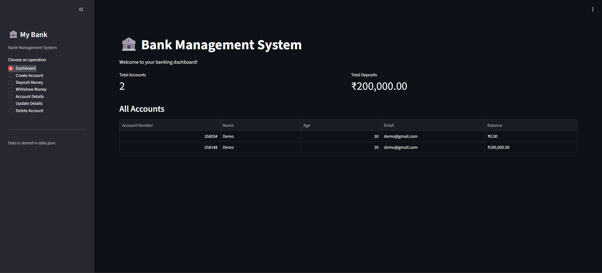
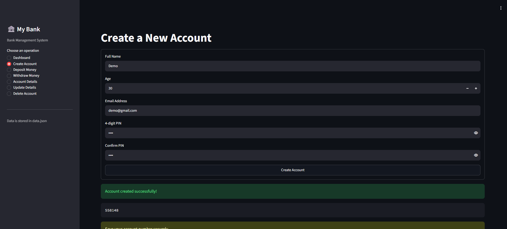

🏦 Bank Management System

A simple, interactive banking application built with <b>Python</b>, <b>Streamlit</b>, and <b>JSON</b>.
 
Create accounts, manage balances, and perform banking operations through a clean web interface.

<a href="#-features">Features</a> •
<a href="#-screenshots">Screenshots</a> •
<a href="#-installation">Installation</a> •
<a href="#-author">Author</a>

✨ Features
Feature	Description
🆕 Account Creation	Create accounts with personal details and a PIN.
💰 Deposit Money	Add money and update account balances.
💸 Withdraw Money	Withdraw funds after PIN and balance verification.
👤 Account Details	View account information securely after PIN verification.
✏️ Update Details	Update account name and email.
🗑️ Delete Account	Remove accounts after verification and confirmation.
📊 Dashboard	View accounts and total balances.
💾 JSON Storage	Save account data locally in a JSON file.
📸 Screenshots

<b>🏠 Dashboard</b>
  

<b>🆕 Create Account</b>
  

<b>👤 Account Details</b>
  

Note: Add your real application screenshots to the screenshots directory. GitHub cannot display local images that have not been uploaded to the repository.
🛠️ Tech Stack

&nbsp;

Python — Application logic and banking operations.
Streamlit — Interactive web interface.
JSON — Persistent local data storage.
Pathlib — File path handling.
📂 Project Structure
Bank-Management-System/
│
├── app.py                  # Main Streamlit application
├── data.json               # Account database
├── requirements.txt        # Python dependencies
├── README.md               # Project documentation
│
└── screenshots/
    ├── dashboard.png
    ├── create-account.png
    └── account-details.png

🚀 Installation
1. Clone the repository
git clone https://github.com/devankit624/Bank-Management-System.git

2. Navigate to the project folder
cd Bank-Management-System

3. Install dependencies
pip install -r requirements.txt

4. Initialize the database

Create data.json with an empty JSON list if the file does not already contain valid account data.

[]

5. Run the application
streamlit run app.py

Open the local URL displayed in your terminal, usually:

http://localhost:8501

📦 Requirements

Your requirements.txt should contain:

streamlit

💾 Data Storage

Account records are stored in data.json. The application reads the file on startup and saves successful account and balance changes.

Example database structure:

[
  {
    "name": "Example User",
    "age": 22,
    "email": "user@example.com",
    "pin": "1234",
    "account_no": 456789,
    "balance": 5000.0
  }
]

Use only fictional example data in public repositories.

🔒 Security Notice

This project is intended for educational purposes. The current implementation stores PINs in plain text and is not suitable for real banking.

For production use, implement secure PIN hashing, proper authentication and authorization, exact financial arithmetic, and a transactional database.

🔮 Future Improvements
📜 Transaction history
📈 Interactive financial charts
🔐 Secure authentication
🧾 Downloadable account statements
🗄️ SQLite or PostgreSQL integration
☁️ Online deployment
👨‍💻 Author

  

GitHub: @devankit624

📄 License

This project is intended for learning and educational use. Add a LICENSE file to specify the terms under which others may use, modify, or distribute the project.

⭐ <b>If you find this project useful, consider starring the repository!</b>
  
Made with ❤️ using Python and Streamlit.

